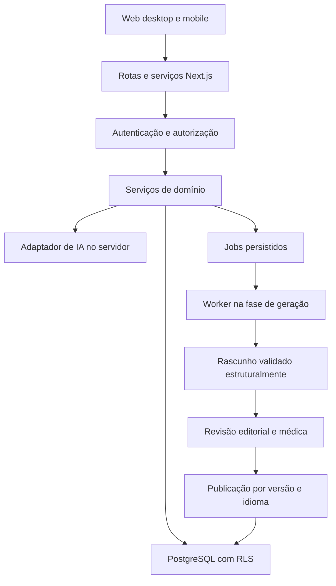

# Arquitetura e execução multiagente

## Status e requisitos

A fundação e a primeira fatia vertical demonstrativa estão implementadas: Next.js/TypeScript, landing pública bilíngue em `/`, área de estudo em `/app`, lição de débito cardíaco, progresso local, biblioteca/perfil locais e pt-BR/en independentes. A fundação AI-native server-only também está implementada com workflow de rascunho, provider port, prompts/evidências versionados, limites, metadados e evals offline. O restante deste documento descreve a arquitetura de evolução; Supabase, autenticação, provedor de IA live, FSRS, Canvas e publicação médica não estão implementados. Conteúdo e testes unitários foram delegados em escopos disjuntos; fundação, contratos, UI e integração ficaram com o coordenador.

Checkpoint atual executado com sucesso: typecheck, lint, 137 testes unitários, build e 32 testes E2E. Inclui a landing pública, a migração da área de estudo para `/app`, navegação entre as duas superfícies, preservação de idiomas/progresso e gate médico. E2E cobre Chrome desktop e emulação mobile, sem validação em aparelho físico. Há gate padrão de produção para conteúdo demonstrativo sem revisão médica. Ver [README.md](README.md) para executar e conhecer os limites.

Referências:
- [Produto medicina e idiomas](research/wondering/MEDICINA.md)
- [Experiência interna observada](research/wondering/MAPA-INTERNO.md)
- [Plano e referências públicas](research/wondering/PLANO.md)

Objetivo: experiência semelhante ao Wondering para estudantes de medicina, com identidade própria, pt-BR/en, trilhas, microlições, questões, tutor e revisão. Preservar composição visual e interações observadas. Comportamentos ainda não verificados serão identificados como decisões próprias.

## Fundação AI-native e versionamento

A arquitetura AI-native é detalhada em [docs/AI-NATIVE.md](docs/AI-NATIVE.md); a decisão está em [ADR 0001](docs/adr/0001-ai-runtime.md). O workflow implementado recebe evidências selecionadas no servidor e retorna somente rascunhos, sem escrever no catálogo, progresso ou XP. A aplicação demonstrativa continua independente desse workflow até existirem autorização e infraestrutura apropriadas. Não há RAG automatizado nem chamadas a um modelo real.

O repositório Git local está inicializado no diretório do projeto. O protótipo inicial foi registrado no commit 30e1805. O incremento AI-native passou no checkpoint local: typecheck, lint, 134 testes unitários (50 de IA), build e 12 E2E, antes de seu commit. Fontes/lockfile/regras/CI são versionados; segredos, dependências, builds e materiais da sessão autenticada ficam fora do Git. CI foi definida, mas não executada em serviço remoto. Nenhum remote/push foi configurado.

## 1. Decisões de arquitetura

### Monólito modular, não microserviços

Uma aplicação Next.js/TypeScript, organizada por domínio, com PostgreSQL/Supabase. Componentes não acessam tabelas diretamente: usam serviços e adaptadores definidos por contratos. Banco, tipos e interface não devem existir como três projetos incompatíveis.

| Responsabilidade | Escolha inicial proposta |
| --- | --- |
| Web responsiva | Next.js + TypeScript |
| UI | Tailwind/CSS, componentes acessíveis, tokens próprios baseados nas referências |
| Internacionalização | next-intl; mensagens pt-BR/en e conteúdo localizado separado |
| Validação de dados | Zod, inclusive para conteúdo e respostas de IA |
| Persistência e conta | Supabase Auth, PostgreSQL e RLS |
| Arquivos | Storage somente quando necessário, com política de acesso |
| Testes | Vitest + Playwright; testes de integração do banco na etapa correspondente |
| Dependências | Um gerenciador, inicialmente npm, um lockfile; versões fixadas no bootstrap após verificar Node/compatibilidade |
| IA | Provider port server-only e workflow de rascunho implementados; fixture explícita; cotas distribuídas e provider live futuros |
| Tarefas demoradas | Jobs persistidos e worker somente na fase de geração; não dentro de requisição longa do navegador |

Não adicionar Redis, Kubernetes, banco vetorial ou event bus sem necessidade medida. Busca inicial pode usar PostgreSQL; separar serviço somente quando requisitos de escala, runtime ou responsabilidade justificarem.

### Fronteiras

- `marketing`: apresentação pública e FAQ em `/`, sem importar as fixtures médicas, questões ou gabaritos. O gate continua no servidor em `/app`; com ele fechado, a landing apresenta o escopo sem oferecer acesso indisponível. A preferência de interface é compartilhada pelo ProgressStore sem alterar idioma de estudo, conclusão ou XP.
- `learning`: trilhas, leitor, exercícios e requisitos de desbloqueio.
- `progress`: conclusão, XP, streaks e fila de revisão.
- `content`: conteúdo canônico, traduções, fontes e revisão editorial/médica.
- `discovery`: biblioteca, busca e apresentação da criação de trilhas.
- `tutoring`: contexto da lição e respostas do assistente, em fase posterior.
- `identity`: conta, preferências, idioma e permissões.

Não criar uma abstração genérica de repositório para tudo. Contratos pequenos correspondem às operações usadas pelo produto, como carregar trilha e concluir lição.

## 2. Fluxo de dados



O diagrama representa componentes lógicos, não oito serviços a implantar. Para o protótipo, serviços usam fixtures e adaptador local; banco e IA entram em etapas próprias. Não expor chaves privilegiadas de Supabase ou IA no cliente.

## 3. Modelo de domínio mínimo

Nomes conceituais propostos; schema SQL e contratos finais serão fechados no bootstrap.

| Grupo | Entidades e invariantes |
| --- | --- |
| Identidade | Profile e Preferences: idioma da interface, idioma de estudo e fuso horário separados |
| Currículo | Course, Section, Lesson e LearningObjective com IDs estáveis |
| Conteúdo | ContentRevision e LocalizedContent: versão-base, locale, corpo estruturado e status |
| Avaliação | Question, Option, AnswerKey e QuestionLocalization; IDs de alternativas estáveis entre traduções |
| Evidência | Source e Citation verificadas, vinculadas à versão do conteúdo |
| Governança | ReviewDecision: revisor autorizado, versão, idioma, data e decisão |
| Aprendizado | Enrollment, LessonProgress, Attempt e ReviewCard |
| Recompensas | XPEvent com regra de unicidade; datas derivadas da política de fuso |
| Operações futuras | GenerationJob, UsageEvent e ContentIssueReport |

### Bilinguismo

- Mensagens de interface não são o banco de conteúdo médico.
- Trocar locale não cria outra inscrição, outro progresso ou outra recompensa.
- Agendamento de revisão se vincula à questão/objetivo, não à string traduzida.
- Uma revisão de tradução não pode apontar para uma versão-base incompatível.
- Questões usam IDs de alternativas, não posição A/B/C nem texto traduzido como gabarito.
- Alteração substancial de objetivo ou gabarito exige política explícita de versionamento e migração de revisão; não reutilizar cegamente o histórico anterior.
- Tradução pendente deve ser indicada. Não mudar idioma, unidades ou diretrizes silenciosamente.

### Conclusão e segurança

No protótipo local, o progresso não é autoridade de produção. Na versão com backend:

- Identidade da operação vem da sessão, não de um user_id confiado ao cliente.
- Verificar inscrição, acesso e pré-requisitos no servidor.
- Conclusão, progresso e XP são gravados atomicamente. Além da chave de idempotência da requisição, aplicar unicidade semântica para impedir recompensa repetida com outra chave.
- Tentativas e política de recompensas de revisão precisam de regras próprias; revisão legítima não deve ser bloqueada como duplicata de conclusão.
- RLS isola dados dos estudantes. Papéis editoriais e administrativos têm autorização distinta.
- Gabaritos e rascunhos clínicos não pertencem ao payload público do estudante. Proteger por permissões/schema/serviço, não apenas escondendo na interface.

## 4. Conteúdo médico e IA

Validação de schema não valida medicina. Revisão por outro agente também não equivale a revisão médica qualificada.

Fluxo editorial: `draft → in_review → approved → published`; permitir `withdrawn` e registrar decisões. Publicação exige versão-base e tradução aprovadas, fontes verificadas e revisor autorizado. Uma edição clínica ou tradução alterada invalida a aprovação correspondente; conservar histórico, não sobrescrever evidências.

Para viabilizar o início:

1. Pequeno catálogo demonstrativo, restrito a desenvolvimento/revisão até aprovação.
2. Primeira versão pública com catálogo revisado e trilhas compostas a partir dele.
3. IA pode propor planos e rascunhos; conteúdos novos não entram automaticamente no catálogo dos estudantes.
4. Tutor informa a natureza gerada da resposta e usa fontes selecionadas, mas isso não garante ausência de erro. Não substituir supervisão ou atendimento.

Esta é uma diferença deliberada em relação à geração irrestrita de qualquer assunto. Revisão médica é uma dependência operacional real, não um detalhe que mais agentes de programação resolvem.

Casos são fictícios. Não aceitar prontuários reais no MVP. Não copiar atlas, livros ou bancos pagos sem licença. Configurar retenção, acesso e logs evitando dados pessoais e prompts sensíveis.

Na fase de geração, usar jobs com status, timeout, número máximo de tentativas, lease e recuperação após falhas. Uma fila persistida no PostgreSQL pode ser suficiente; execução é potencialmente ao menos uma vez e consumidores precisam ser idempotentes. Escolher provedor de worker hospedado no momento da implantação. Controlar uso, concorrência e custo por usuário; respostas de IA nunca autorizam ferramentas ou publicação por conta própria.

## 5. Organização proposta e ownership

A estrutura básica abaixo já foi criada; caminhos de backend e serviços futuros só serão adicionados quando atribuídos. Nenhum agente cria estruturas concorrentes fora de seu escopo.

| Papel | Escrita exclusiva | Entrega |
| --- | --- | --- |
| Coordenador/integrador | `src/app/**`, `src/contracts/**`, configurações raiz, manifests/lockfile, CI, `docs/coordination/**` | Fundação, contratos, composição das rotas e aceite integrado |
| UI e fidelidade | `src/ui/**`, `src/features/shell/**`, `src/features/marketing/**`, `src/features/discovery/**`, `public/brand/**` | Tokens, shell, Home estrutural, Library/Create e comportamento responsivo |
| Aprendizagem | `src/features/learning/**` | Trilha, leitor, exercícios, regras de progressão e serviços de progresso |
| Conteúdo e idiomas | `content/**`, `src/i18n/**`, `public/lesson-diagrams/**` | Fixtures bilíngues, mensagens, glossário e conteúdo versionado; sem autoaprovação médica |
| Dados e identidade | `src/data/**`, `src/auth/**`, `supabase/**` | Adaptadores local/remoto, autenticação, migrations e RLS |
| QA e integração | `tests/**`, `test-fixtures/**` | Testes de contratos, fluxos, acessibilidade, banco e comparação visual |

O coordenador pode executar parte desses papéis. Começar com três agentes de implementação simultâneos após a fundação; ativar mais quando houver tarefas independentes suficientes. Seis papéis não exigem seis agentes permanentemente ativos.

Home estrutural é do agente UI; os componentes da trilha são do agente Aprendizagem; a rota é do coordenador. Contratos determinam essa composição. Testes ficam centralizados para evitar autoria sobreposta. CSS global tem um único dono; outros componentes usam estilos locais ou tokens.

### Regras no workspace compartilhado

- Um escritor por arquivo, inclusive documentação de coordenação.
- Sem branches ou worktrees sem autorização do usuário. Esta estratégia usa diretórios disjuntos no mesmo workspace.
- Somente coordenador instala dependências e altera configurações/lockfile.
- Somente agente de dados escreve migrations, com ordem reservada e revisão do coordenador. Não editar migration já aplicada em ambiente compartilhado.
- Agentes solicitam alterações em contratos em vez de inventar novas versões locais.
- Agente QA relata falhas ao dono; não corrige código alheio silenciosamente.
- Sem formatador com escrita global, resets, limpeza de arquivos alheios ou commits não solicitados.
- Integração e revisão não se resumem a juntar arquivos ao final.

## 6. Etapas e gates

### 0 — Contratos e escopo (serial)

Coordenador fecha uma fatia cardiovascular, rotas, tokens, IDs, formatos de exercício, interfaces dos adaptadores, erros, locales e cenários de aceite. Define limites entre observado e proposto.

Pronto: fixtures comuns, mapa de ownership e contratos pequenos suficientes para uma lição completa.

### 1 — Fundação executável (serial)

Criar projeto, fixar dependências e runtime, configurar i18n, testes, rotas mínimas e comandos de validação. Escolher referências visuais locais como base da revisão; testes normais não dependem da conta Wondering.

Pronto: instalação reproduzível, typecheck, teste mínimo e build passando. Não distribuir scaffold entre agentes.

### 2 — Fatia vertical demonstrativa (paralela)

- UI: shell desktop/mobile e composição da Home.
- Aprendizagem: trilha → leitor → exercício → feedback → revisão.
- Conteúdo/i18n: mesmo módulo em pt-BR/en e diagramas próprios.
- Dados: adaptador local apenas quando contrato estiver fechado.
- QA: fixtures e primeiros testes integrados, sem esperar a conclusão de todas as telas.

O coordenador conecta incrementos pequenos às rotas reais. Não aceitar só páginas isoladas. O protótipo deve ter caminho feliz e erro/retomada, não apenas animação de navegação.

Pronto: fluxo bilíngue completo, progresso preservado no dispositivo, sem XP duplicado e comparação visual em desktop/mobile. Conteúdo ainda não aprovado permanece em ambiente de desenvolvimento/revisão.

### 3 — Conta e backend real (paralelismo limitado)

Dados implementa migrations/Auth/RLS; Aprendizagem integra o adaptador remoto; UI completa estados de login/carregamento/erro; QA testa banco com duas identidades. Coordenador resolve contratos entre consumidores.

Pronto: login, retomada entre sessões, isolamento entre usuários, operações idempotentes e proteção de rascunhos/gabaritos com testes reais. Mocks não comprovam RLS.

### 4 — Publicação controlada e beta

Completar catálogo revisado, Library/Create reais, processo editorial, observabilidade, cotas e relatório de erro de conteúdo. Testar atualização de versões e indisponibilidade de tradução. Obter revisão médica qualificada antes de publicação.

Pronto: aprovação editorial/médica por versão/idioma, deploy de teste, jornada fim a fim e fluxo de retirada de conteúdo incorreto.

### 5 — Expansão

Tutor e geração supervisionada, Canvas, áudio/vídeo, recursos sociais e cobrança entram como entregas separadas. Não colocar todos no primeiro sprint. Prazo e custo só devem ser estimados após a fundação e uma fatia medida.

## 7. Contrato de tarefa para cada agente

Todo despacho deve conter:

```text
Objetivo: um resultado observável e pequeno.
Dependências: contratos, fixtures e componentes já disponíveis.
Pode editar: arquivos/diretórios exclusivos.
Não pode editar: rotas/contratos/configurações de outro dono.
Deve suportar: pt-BR/en, desktop/mobile, erro e carregamento aplicáveis.
Critérios de aceite: cenários verificáveis, não apenas 'criar componente'.
Validação: testes/comandos específicos e evidências visuais quando aplicável.
Handoff: arquivos alterados, contratos consumidos, validação executada,
         limitações, bloqueios e instruções necessárias para integração.
```

Exemplo: implementar o leitor bilíngue a partir de LessonView, com etapas anterior/próxima e retomada via ProgressStore, em `src/features/learning/reader/**`. Não instalar pacotes, criar rotas, alterar mensagens ou gerar conteúdo médico. Entregar cobertura para mudança de idioma sem reiniciar etapa e uma captura nas duas resoluções.

## 8. Validação e operação dos agentes

- Verificação curta por incremento: tipos, schema runtime e testes específicos do domínio.
- Fixtures de contrato compartilhadas entre UI, serviços e adaptadores; QA mantém cenários sem duplicar schemas.
- Testes de locale: interface e estudo independentes, alternância, persistência, fallback explícito, diagramas e gabaritos equivalentes.
- Testes de domínio: conclusão repetida/concorrente, revisão, mudança de dia/fuso e atualização de versão.
- E2E: trilha → lição → exercício → feedback → retomada, nos dois idiomas; autenticação/backend quando implementados.
- Segurança: dois usuários, rascunhos inacessíveis a estudantes, gabaritos protegidos, tentativas não autorizadas e cotas de IA.
- Visual: 1366 × 900 e 390 × 844 inicialmente; verificar também larguras intermediárias. Fontes próprias/licenciadas e referências locais, sem usar a conta real em CI.
- Checkpoint de integração: agentes pausam escrita; coordenador executa instalação congelada, typecheck, lint, testes, build e E2E. Não atribuir falhas de estado intermediário antes de um checkpoint estável.
- Agentes não marcam a própria tarefa integrada só por compilar; o consumidor e o fluxo precisam funcionar.
- Não aceitar aprovação de conteúdo clínico por votação entre agentes. Automação verifica estrutura e referências disponíveis; especialista humano valida publicação médica.

## Próxima ação

Etapas 0 e 1 concluídas, com uma fatia demonstrativa da etapa 2 integrada e testada. Antes de ampliar o escopo, revisar a experiência da lição. Os contratos reais estão em src/contracts/learning.ts; o consumidor em src/features/learning/learning-app.tsx; o adaptador em src/data/local-progress.ts. Próximas tarefas devem consumir esses contratos, não criar outra estrutura de progresso/localização.

Próxima rodada sugerida: UI refina fidelidade e acessibilidade; conteúdo prepara novas lições como rascunhos bilíngues; QA amplia cobertura de navegação e persistência; dados planeja a migração para Supabase sem implementar um backend inteiro em paralelo sem aprovação dos contratos. Especialista médico revisa o material antes de qualquer publicação educacional.
