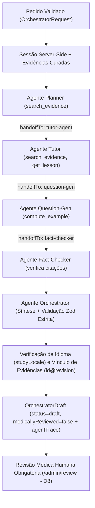

# Fundação AI-Native e Arquitetura Multi-Agente SOTA do Medora

## O Que Este Termo Significa Aqui

Dois pilares complementares e já operacionais no código:

1. **Produto com Núcleo Multi-Agente e Cognitivo Server-Only (`src/ai/`):**
   - Orquestrador hierárquico multi-agente (`src/ai/agents/orchestrator.ts`) coordenando especialistas (`planner`, `tutor-agent`, `question-gen`, `fact-checker`) com ferramentas auditadas (`search_evidence`, `get_lesson`, `compute_example`), memória de sessão (`session.ts`) e proveniência completa (`agentTrace`).
   - Serviços estruturados de Plano de Estudo (`study-plan-service.ts`), Tutoria Contextual (`tutor-service.ts`) e Repetição Espaçada FSRS (`fsrs-scheduler.ts`).
   - Contratos Zod estritos (`src/contracts/ai.ts`), prompts e evidências versionados (`src/ai/prompts/`, `src/ai/evidence/`), adapters offline determinísticos (`fixture.ts`, `agent-fixture.ts`) e adapter `live` fail-closed (`live.ts`).
2. **Engenharia Orientada a Agentes Autônomos (`AGENTS.md`, `agents/*.md`, `docs/coordination/`):**
   - O **Agente Coordenador (Orquestrador)** e os **6 Agentes Especialistas** (`AI-Engineer`, `Learning`, `UI/UX`, `Content-Médico`, `Dados`, `QA`) operam com autonomia ponta-a-ponta: decompõem pedidos múltiplos, fecham contratos primeiro, executam em diretórios disjuntos e rodam o loop de auto-cura em 3 barreiras (`typecheck`/`lint` → `ai:eval` → `vitest`/`build`/`e2e`).

---

## Módulos Implementados na Camada de IA

```text
src/contracts/ai.ts                       Contratos Zod: StudyPlan, Tutor, Multi-Agent Orchestrator, Evidence, RunRecord
src/ai/runtime.ts                         Composição unificada (studyPlan, tutor, agents) em modo fixture ou live (fail-closed)
src/ai/agents/orchestrator.ts             Supervisor multi-agente com loop de handoffs, ferramentas, limites e agentTrace
src/ai/agents/definitions.ts              Definições declarativas (orchestrator, planner, tutor-agent, question-gen, fact-checker)
src/ai/agents/tools.ts                    Ferramentas determinísticas auditadas (search_evidence, get_lesson, compute_example)
src/ai/agents/session.ts                  Memória bounded de sessão server-side (mensagens + handoffs)
src/ai/study-plan-service.ts              Workflow de rascunho de plano de estudo
src/ai/tutor-service.ts                   Workflow de rascunho de tutoria contextual
src/ai/fsrs-scheduler.ts                  Agendador cognitivo FSRS (stability, difficulty, retrievability, nextDue)
src/ai/prompts/                           Prompts versionados (study-plan-v1, tutor-v1 e prompts/agents/*)
src/ai/evidence/                          Evidências curadas e versionadas (cardiovascular, cardiac-cycle, heart-electrical)
src/ai/providers/                         Adapters fixture.ts, agent-fixture.ts e live.ts (OpenAI-compatible server-side)
src/app/actions/agents.ts                 Server Action para execução segura do orquestrador a partir de CreatePage
tests/ai/                                 60 avaliações determinísticas offline (study-plan, agents, boundaries)
```

---

## Fluxo Executável do Orquestrador Multi-Agente



---

## Princípios SOTA de Confiabilidade e Segurança

1. **Constrained Decoding & Rejeição Estrita:**
   - Todos os schemas usam `z.strictObject()`. Qualquer tentativa de um provider ou agente injetar campos de publicação (`published: true`), URLs externas não curadas ou ferramentas fora de `allowedTools` é rejeitada com `INVALID_OUTPUT`.
2. **Isolamento Contra Prompt Injection:**
   - Metas do usuário (`goal`), tópicos (`topic`), dúvidas (`question`) e textos de fontes entram exclusivamente serializados como JSON no campo `user` do `PromptEnvelope`, nunca concatenados nas instruções `system`.
   - O histórico de handoffs (`AgentHandoff.reason`) usa rótulos fixos (`handoff ${from}→${to}`), impedindo propagação de payload não confiável na telemetria.
3. **Orçamento, Concorrência e Timeout Determinísticos:**
   - Controle por serviço de `maxInputBytes`, `maxOutputBytes`, `maxOutputTokens`, `timeoutMs` (com `AbortController`) e `maxConcurrent`.
   - O slot de concorrência permanece reservado até a promise do provider finalizar, mesmo se o provider ignorar o sinal de abort.
4. **Telemetria Higienizada (`RunRecord` & `AgentRunRecord`):**
   - Callbacks `onRun` e `onAgentRun` registram apenas IDs, versões, `studyLocale`, contagem de `steps`/`handoffs`/`toolCalls`, `outcome`, `errorCode`, `elapsedMs` e `usage` — zero vazamento de prompts, respostas ou dados pessoais.
5. **Separação Inegociável entre Validação Técnica e Aprovação Clínica:**
   - Citações válidas (`evidenceKeys`) comprovam vínculo técnico com a coleção de evidências fornecida, nunca veracidade clínica automática.
   - Todo artefato gerado permanece `status: 'draft'` e `medicallyReviewed: false` até revisão médica humana (D8).

---

## Comandos de Verificação

```sh
npm run ai:eval
npm test
npm run typecheck
npm run lint
npm run build
```
