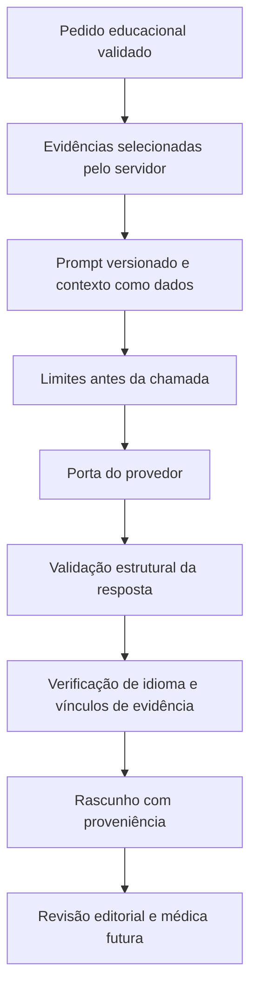

# Fundação AI-native do Medora

## O que este termo significa aqui

Dois requisitos diferentes:

1. **Produto com núcleo preparado para IA:** workflows explícitos, contexto/evidências selecionados pelo servidor, provider substituível, contratos de saída, prompts e schemas versionados, limites, rastreabilidade e avaliações.
2. **Engenharia preparada para agentes:** contexto em AGENTS.md, decisões em ADRs, tarefas pequenas, ownership, testes executáveis e histórico Git.

AI-native não exige microserviços nem que cada clique chame um modelo. Também não significa permitir agentes sem supervisão publicarem medicina.

## Implementado nesta entrega

```text
src/contracts/ai.ts                Entrada, saída, evidência, provider e rastreabilidade
src/ai/study-plan-service.ts        Orquestração de um rascunho de plano de estudo
src/ai/prompts/study-plan-v1.ts     Prompt medical-study-plan@1.0.0
src/ai/evidence/cardiovascular.ts   Evidência selecionada e versionada
src/ai/providers/fixture.ts        Adapter determinístico exclusivamente offline
src/ai/runtime.ts                 Composição explícita; modo live indisponível
tests/ai/                         Avaliações técnicas offline e testes de fronteira
```

Os módulos de implementação importam `server-only`. Contratos não carregam segredos e podem ser consumidos como tipos. O alias de `server-only` no Vitest vale apenas em testes; o compilador Next mantém a barreira real. O teste de grafo de imports cobre a aplicação atual, mas não substitui análise estática completa nem testes negativos do compilador para toda forma possível de importação.

## Fluxo executável



A UI existente continua lendo a lição demonstrativa. O workflow novo ainda não está ligado ao botão Criar, a um endpoint, a uma conta ou ao catálogo. Isso evita expor consumo pago e rascunhos clínicos por uma API sem autenticação/autorização.

## Contratos e confiança

- Entrada contém assunto, etapa do estudo e idioma de estudo; idioma da interface não determina conteúdo clínico.
- O provider só pode retornar título, locale e lições com IDs, objetivos e chaves de evidência.
- Campos extras de aprovação, publicação, ferramentas ou URLs são rejeitados.
- O serviço atribui `status=draft` e `medicallyReviewed=false`, independentemente de formato ou idioma.
- Toda chave de evidência precisa existir na coleção fornecida, incluindo sua revisão.
- Uma citação válida demonstra vínculo técnico à fonte, **não que a afirmação seja verdadeira ou sustentada por ela**. O sistema não possui verificação automática de entailment clínico.
- Não há busca, leitura arbitrária de URLs, ferramentas autônomas ou RAG implementado. A evidência atual é um pequeno registro curado derivado da referência OpenStax pesquisada.
- Fontes e tópicos são dados não confiáveis em JSON; não controlam mensagens de sistema, provider, limites ou permissões. Delimitadores não tornam um modelo imune a prompt injection. Evals de fixture não comprovam essa resistência em um modelo real.

## Limites e observabilidade

Por instância do serviço: no máximo quatro chamadas simultâneas configuráveis, padrão uma; uma tentativa por pedido, sem retries automáticos; deadline padrão 15 segundos; teto de entrada/saída em bytes UTF-8 e teto solicitado de tokens de saída. Configurações têm limites superiores definidos por schema, e o pedido não pode alterá-las.

O timeout retorna erro controlado e aborta o sinal. Se o provider ignorar cancelamento, o slot permanece reservado até ele encerrar. Isso impede liberar capacidade fictícia, mas não interrompe consumo remoto por si só. Não são cotas distribuídas nem garantia financeira. Antes de uma integração pública, adicionar reserva persistida de uso/custo, autenticação, limitação por usuário e jobs duráveis.

O callback de observabilidade recebe somente metadados permitidos: ID de execução, provider/kind, versões, idioma, resultado/código de erro, duração e uso quando informado. Não recebe assunto, prompt, textos de fontes, resposta ou mensagem bruta do erro. Uso ausente permanece desconhecido; não equivale a zero tokens ou custo zero. O host deve fornecer um sink durável; atualmente o callback não é armazenamento.

Rejeições de entrada/limites antes do provider não criam execução nem evento neste serviço. A futura borda HTTP deverá medir rejeições sem registrar dados sensíveis.

## Avaliações

```sh
npm run ai:eval
npm run validate
```

`ai:eval` executa fixtures determinísticas sem chaves nem modelo remoto. Cobre estrutura e identidade, idiomas, evidências, metadados, orçamento técnico, concorrência, falhas e cancelamento. O adapter é identificado como `fixture` nos resultados. `createAiRuntime({ mode: 'live' })` falha explicitamente; não há fallback silencioso.

Evals verdes não são aprovação médica, avaliação de qualidade de um LLM ou evidência de aprendizado dos estudantes. Uma etapa futura precisa de dataset revisado por especialistas, comparação de providers, critérios de factualidade, suporte das fontes e revisão humana.

## Antes de habilitar IA real

1. Escolher provider/modelo, política de dados e orçamento com o usuário.
2. Implementar adapter servidor e gerir credencial fora do Git; nunca pedir segredo no chat.
3. Adicionar conta, autorização, quotas persistidas e jobs quando houver geração longa.
4. Definir licença e governança das fontes, versão e retenção dos artefatos.
5. Executar evals com um conjunto revisado, registrar custo/latência e limites reais.
6. Implementar revisão/editorial e médica separada da geração. Nenhum provider pode publicar.
7. Só então conectar a experiência de criação/tutoria da interface.

## Arquivos locais e Git

O projeto e o diretório `.git` ficam em `C:\Users\marlo\Downloads\Startup`. Git local fornece histórico, não backup externo. Nenhum remote ou push foi configurado nesta entrega. Para proteção contra perda do computador, será necessário um destino de backup ou remoto privado, com autorização.

Capturas e scripts específicos da sessão autenticada ficam no computador, mas estão ignorados pelo Git. Não são necessários para build, testes ou execução. Referências públicas e a implementação própria continuam versionadas.
